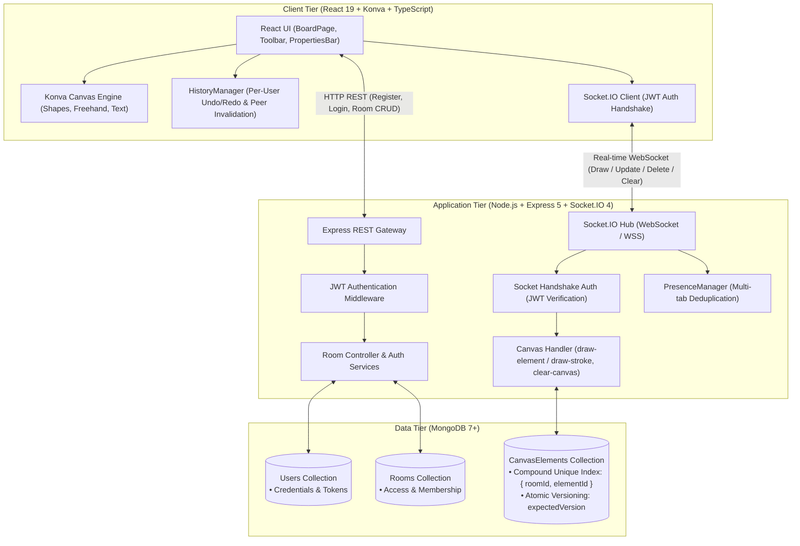

# BoardCollab — Real-Time Collaborative Whiteboard

BoardCollab is a full-stack real-time collaborative whiteboard platform built with Node.js, Express, Socket.IO, MongoDB, React, TypeScript, and Konva.

---

## System Architecture Diagram



- **Backend**:
  - **Runtime & API**: Node.js, Express 5 REST API (Authentication, Room Management).
  - **Real-Time Engine**: Socket.IO 4 with JWT handshake authentication, room presence tracking, and broadcast echo-avoidance.
  - **Persistence & Concurrency**: MongoDB with Mongoose. Compound unique indexes `{ roomId, elementId }` prevent duplicate elements. Concurrency and conflict handling is implemented using atomic Optimistic Concurrency Control (OCC) with `expectedVersion` and MongoDB `$inc: { version: 1 }` (detecting and rejecting conflicting concurrent edits with 409 responses). Note: The system uses OCC, not Operational Transformation (OT / `ot-json0`) or Conflict-Free Replicated Data Types (CRDTs).
  - **Test Suite**: Native Node.js test runner (`node:test`, `node:assert`, `--experimental-test-coverage`).
- **Frontend**:
  - **Framework & Build**: React 19, TypeScript, Vite.
  - **Canvas Engine**: HTML5 Canvas rendering via Konva and `react-konva`.
  - **State Management**: Redux Toolkit for auth and boards, optimized custom hooks and `HistoryManager` for local undo/redo with peer conflict invalidation.
  - **Exports & Clear**: Client-side PNG and standalone scalable SVG export with XML sanitization; interactive Clear Canvas tool with modal confirmation.

---

## Prerequisites

- **Node.js**: v20+ or v24+ (Tested on Node.js `v24.11.0`)
- **MongoDB**: v6+ or v7+ running locally on port 27017 (`mongodb://localhost:27017/boardcollab`)
- **Operating System**: Windows (PowerShell), macOS, or Linux

---

## Getting Started

### 1. Backend Setup

```powershell
cd backend
npm install
npm run dev
```

The backend server runs on `http://localhost:5000`.

### 2. Frontend Setup

In a new terminal:

```powershell
cd frontend
npm install
npm run dev
```

The frontend application runs on `http://localhost:5173`.

---

## Testing & Quality Assurance

### Backend Automated Tests

BoardCollab includes 139 automated tests (49 suites) covering authentication, room access control, canvas schema validation, real-time drawing, CRDT property-level conflict resolution, reliability edge cases, canvas clearing, and server-side PNG exports.

```powershell
cd backend

# Run all backend unit and integration tests (139 tests)
npm test

# Run tests with code coverage reporting (89.27% line coverage)
npm run test:coverage

# Run 20-client concurrent collaboration tests
npm run test:concurrency

# Run reliability & edge-case regression tests
npm run test:reliability
```

### Frontend Automated Tests & Linting

```powershell
cd frontend

# Run frontend unit tests (50 tests)
npm test

# Run frontend coverage report (85.23% line coverage)
npm run test:coverage

# Run ESLint check
npm run lint

# Compile production build
npm run build
```

---

## Server-Side Room Export API (PNG via `node-canvas`)

BoardCollab provides an authenticated server-side export endpoint that retrieves the persisted MongoDB canvas state and renders a server-rendered PNG image using `node-canvas`.

### Endpoint Definition

`POST /api/rooms/:id/export`

- **Authentication**: Required (`Authorization: Bearer <jwt_token>`).
- **Access Control**: Users can export any public room, or private rooms they own or are members of. Non-members receive `403 Forbidden`.
- **Supported Shapes**: Freehand strokes (paths), rectangles, circles, and text elements with full color, opacity, font size, and stroke width support.
- **Request Headers**:
  - `Authorization: Bearer <jwt_token>`
  - `Content-Type: application/json` (optional when passing configuration options)
- **Request Body (Optional)**:
  ```json
  {
    "backgroundColor": "#080c14",
    "padding": 40,
    "allowEmpty": true
  }
  ```
- **Response**:
  - **Status**: `200 OK`
  - **Content-Type**: `image/png`
  - **Content-Disposition**: `attachment; filename="<roomId>.png"`
  - **Body**: Binary PNG image buffer.

### Error Responses
- `401 Unauthorized`: Missing or invalid JWT token.
- `403 Forbidden`: Requesting user is not a member of a private room.
- `404 Not Found`: Room ID does not exist in the database.
- `400 Bad Request`: If `allowEmpty: false` and the room has no canvas elements.

### Example cURL Request

```bash
curl -X POST http://localhost:5000/api/rooms/room-alpha/export \
  -H "Authorization: Bearer $TOKEN" \
  -H "Content-Type: application/json" \
  -d '{"backgroundColor": "#080c14", "padding": 40}' \
  --output room-alpha.png
```

---

## Offline Indicator & Local Draft Recovery

BoardCollab features built-in offline tolerance and resilient client-side draft caching:

1. **Room-Specific Canvas Caching**:
   - Active whiteboard elements in Redux are automatically cached to `localStorage` under isolated room keys (`boardcollab_draft_<roomId>`).
   - Different boards never overwrite each other's drafts.
   - Storage quotas, exceptions, and malformed JSON are handled safely without crashing.

2. **Real-Time Connectivity Indicators**:
   - The topbar displays dynamic connection states: `Live` (connected & in room), `Joining...`, `Disconnected` (reconnecting to WebSocket gateway), or `Offline` (browser network unavailable).
   - Event listeners on `window.online` and `window.offline` detect network transitions immediately and display notification toasts.

3. **Safe Draft Recovery Workflow**:
   - If the server or internet connection is unavailable, the workspace permits access and displays a **Local Draft Available** banner.
   - Users can choose to **Restore Local Draft** to recover their locally cached elements into the Redux whiteboard.
   - When connection returns, BoardCollab preserves authoritative server state and never automatically overwrites server canvases or broadcasts stale cached elements without explicit user recovery action.
   - Canvas clearing (`clear-canvas`) removes both the active board and the room's cached draft to prevent resurrection of cleared elements.

---

## Load Testing & Benchmarks

BoardCollab includes dedicated benchmark scripts to measure canvas scaling and concurrent operation latency.

### 1. Canvas Scale Benchmark (10,000 Elements)

Tests batch insertion, database retrieval, memory consumption, and Socket.IO wire delivery of 10,000 canvas elements:

```powershell
cd backend
npm run benchmark:scale
```

*Configurable environment variables:*
- `ELEMENT_COUNT`: Total elements to seed (default: `10000`)
- `BATCH_SIZE`: Ingestion batch size (default: `1000`)

*Example:*
```powershell
$env:ELEMENT_COUNT="10000"; $env:BATCH_SIZE="1000"; npm run benchmark:scale
```

### 2. Operation Latency & Throughput Benchmark

Simulates concurrent authenticated clients performing realistic drawing operations (strokes, rectangles, circles, text), concurrent updates, and high-contention CRDT property convergence:

```powershell
cd backend
# Default (50 concurrent clients):
npm run benchmark:latency

# Explicit 50-client benchmark:
npm run benchmark:50

# Optional 100-client stress benchmark:
npm run benchmark:100
```

*Configurable CLI flags & environment variables:*
- `--clients=<N>` or `$env:CLIENT_COUNT`: Number of concurrent clients (default: `50`)
- `--draws=<N>` or `$env:DRAWS_PER_CLIENT`: Drawing ops per client (default: `10`)
- `--updates=<N>` or `$env:UPDATES_PER_CLIENT`: Update ops per client (default: `10`)

*Example:*
```powershell
node scripts/latency_benchmark.js --clients=50 --draws=10 --updates=10
```

---

## Measured Performance & Coverage Summary

Detailed measurements are documented in [BENCHMARK_REPORT.md](BENCHMARK_REPORT.md).

| Metric | Measured Value | Standard Target | Status |
| :--- | :---: | :---: | :---: |
| **Backend Line Coverage** | **89.27%** (78.35% branch, 88.00% func) | $\ge 70\%$ | Passed |
| **Frontend Line Coverage** | **85.23%** (63.68% branch, 77.61% func) | $\ge 70\%$ | Passed |
| **Backend Total Passing Tests** | **139 / 139** (49 suites) | 100% | Passed |
| **Frontend Total Passing Tests** | **50 / 50** (16 suites) | 100% | Passed |
| **20-Client Concurrency** | **0 errors, 100% convergence** | 100% | Passed |
| **50 Concurrent Clients Benchmark** | **0 errors, 100% convergence (1,050 ops, 250–356 ops/sec)** | 50+ clients | **Passed** |
| **100 Concurrent Clients Stress Test** | **0 errors, 100% convergence (2,100 ops, 99k peer msgs)** | Optional stress test | **Passed** |
| **10k Elements DB Ingestion** | **622.0 ms (16,077 ops/sec)** | Sub-second | Passed |
| **10k Elements Socket Delivery** | **357.0 ms (3.02 MB payload)** | Sub-second | Passed |
| **Paced Ack Latency (50 clients, 200ms spacing)** | **p50: 15.82 – 20.40 ms \| p95: 31.72 – 132.55 ms** | Human cadence | **Measured** |
| **Paced Peer Delivery (50 clients)** | **p50: 16.06 – 20.74 ms \| p95: 32.34 – 132.70 ms** | 24,500 peer messages | **Measured** |
| **Synthetic Burst Draw Ack (50 clients)** | **p50: 1,216.92 – 1,433.67 ms (p95: 1,303 – 1,778 ms)** | 500 simultaneous ops | Measured |
| **Synthetic Burst Peer Delivery (50 clients)** | **p50: 1,168.80 – 1,424.92 ms** | Simultaneous mesh | Measured |
| **CRDT Contention Conflict Resolution** | **p50: 135.29 – 176.66 ms (100% accepted, 0 rejections)** | Deterministic convergence | Measured |

*Important Benchmark Disclosures:*
- **Tested Client Scale**: Concurrency testing and latency benchmarks were verified with **50 concurrent authenticated clients** (and optionally **100 concurrent clients**) using realistic drawing operations (strokes, rectangles, circles, text) and authorized room access. All operations across all runs completed with a **100% success rate (0 errors)** and verified state convergence.
- **Paced Collaboration vs. Synthetic Burst**:
  - *Paced Load (Realistic Collaboration)*: With 50 clients drawing at realistic 200 ms intervals (~204–228 room ops/sec), steady-state median acknowledgement latency is **15.82–20.40 ms**, and median peer delivery latency is **16.06–20.74 ms**. In two clean runs, p95 remained at **31.72–36.90 ms**. In Paced Run 3, a **latency outlier occurred where p95 rose to 132.55 ms** (p99: 211.46 ms), caused by a single-process Node.js V8 garbage-collection pause (p95 event loop delay: 146.80 ms, p99: 584.06 ms) processing 24,500 socket packet frames in memory.
  - *Synthetic Burst Load (Unpaced Injection)*: When 500 operations were submitted simultaneously with zero pacing, median acknowledgement latency rose to **1,216–1,433 ms**. Direct driver instrumentation proved this is queueing delay in the MongoDB connection pool (wait queue peaking at 982 operations) and sequential connection establishment on an empty initial pool (`minPoolSize = 0`).
  - *Latency Target Notice*: We do **not** claim that every operation stays below 100 ms under synthetic burst saturation or during single-process GC pauses.
- **CRDT Convergence**: Contending updates to the same element converged deterministically according to property-level Last-Write-Wins (LWW) rules with zero OCC 409 rejections.

---

## Assignment Specification Compliance & Implementation Scope

To ensure transparent evaluation, the following breakdown distinguishes completed features from architectural decisions and unverified/omitted items:

### 1. Completed Requirements
- **Authentication**: JWT user registration and login (`POST /api/auth/register`, `POST /api/auth/login`).
- **Board Management**: Creation, retrieval, membership management, and public/private room authorization (`POST /api/rooms`, `GET /api/rooms`, `GET /api/rooms/:id`, `POST /api/rooms/:id/join`, `POST /api/rooms/:id/members`, `POST /api/rooms/:id/leave`).
- **Real-Time Whiteboard**: Interactive Konva canvas supporting freehand pen strokes (`draw-element` and backward-compatible `draw-stroke`), rectangles, circles, and text.
- **Redux Canvas State**: Dedicated Redux Toolkit slice (`canvas.slice.ts`) managing all canvas elements with reactive UI binding.
- **Collaboration Tools**:
  - Per-user undo/redo history (`HistoryManager`) with fine-grained property-overlap invalidation.
  - Clear canvas with confirmation modal, room `clearEpoch` anti-resurrection protection, MongoDB persistence wipe, and peer broadcast.
  - Client-side PNG export, client-side vector SVG export with XML sanitization.
- **Server-Side Room Export Endpoint**: Authenticated `POST /api/rooms/:id/export` generating binary PNG images of persisted canvas elements via `node-canvas`.
- **Session Persistence**: MongoDB database persistence with compound unique indexes `{ roomId, elementId }` preventing duplicate elements across rooms and surviving full server restarts.
- **Offline Tolerance & Draft Recovery**: Room-specific `localStorage` draft caching (`boardcollab_draft_<roomId>`), connectivity status indicator (`Live`, `Joining...`, `Disconnected`, `Offline`), and explicit user draft recovery excluding deleted elements.
- **Automated Tests & Quality**: 139 backend tests, 50 frontend tests, 0 ESLint errors, and clean production build.
- **CRDT Conflict Resolution**: Property-level Last-Write-Wins (LWW) CRDT tracking logical clocks and client ID tie-breakers per mutable property. Independent properties merge cleanly, conflicting writes resolve deterministically, tombstones prevent resurrection, and room clear epochs protect clear-canvas operations.
- **50 Concurrent Clients Scale**: Verified with 50 and 100 live authenticated Socket.IO clients collaborating in a shared room without errors or data loss.

### 2. Implementation Scope Boundaries & Known Limitations
- **Text Conflicts Use Whole-String LWW, Not Character-Level Merging**: Discrete properties (including text content and stroke points) are governed by LWW registers; character-by-character collaborative typing within an active text element (such as RGA, Logoot, or Yjs) is not implemented.
- **Single-Node Socket.IO In-Memory Adapter; Redis Adapter Not Implemented**: Socket.IO runs on the default in-memory adapter suitable for single-server deployment. Horizontal multi-server clustering with a Redis pub/sub adapter is not configured.
- **Docker Compose is Not Provided**: Setup uses local Node.js and MongoDB instances rather than a multi-container Docker Compose environment.
- **Viewport-Based Canvas Culling is Not Implemented**: Konva renders all active canvas elements in the layer; viewport-based bounding-box culling or virtualization for large canvases (>5k elements) is not implemented.
- **Client-Side Isolated Undo/Redo**: Undo/redo stacks are managed per-user on the client (`HistoryManager`) rather than stored in a server-side Redis instance.

---

## Directory Structure

```
BoardCollab/
├── BENCHMARK_REPORT.md         # Full benchmark, load testing, and coverage report
├── README.md                   # Project documentation and setup guide
├── backend/
│   ├── scripts/
│   │   ├── canvas_scale_benchmark.js   # 10k elements scaling benchmark
│   │   ├── latency_benchmark.js        # 50/100-client burst latency & throughput benchmark
│   │   └── paced_benchmark.js          # 50-client realistic paced latency benchmark
│   ├── src/
│   │   ├── controllers/                # Express controllers (auth, room)
│   │   ├── middleware/                 # Auth & validation middleware
│   │   ├── models/                     # Mongoose schemas (User, Room, CanvasElement)
│   │   ├── routes/                     # REST API routes
│   │   ├── services/                   # Business logic & atomic DB operations
│   │   ├── sockets/                    # Socket.IO handlers, auth & presence manager
│   │   └── utils/                      # Validation rules & helpers
│   └── tests/                          # 139 unit, integration & concurrency tests
└── frontend/
    ├── src/
    │   ├── components/                 # Reusable UI & whiteboard components
    │   ├── hooks/                      # Custom hooks for canvas & sockets
    │   ├── pages/                      # LoginPage, RegisterPage, DashboardPage, BoardPage
    │   ├── services/                   # API and Socket.IO client services
    │   ├── store/                      # Redux Toolkit slices (auth, boards)
    │   ├── types/                      # TypeScript definitions & normalizers
    │   └── utils/                      # HistoryManager (undo/redo), export utilities
    └── tests/                          # 50 frontend unit tests
```

---

## License

ISC
